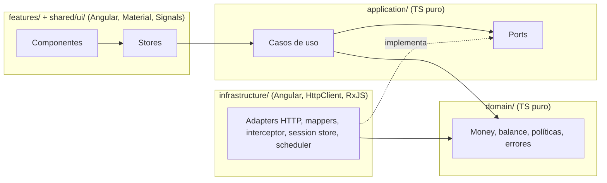
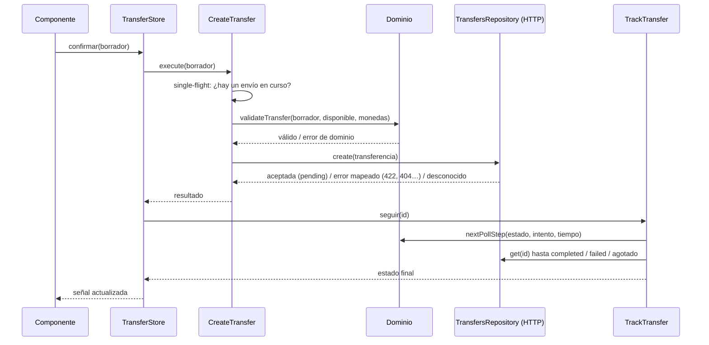

# Arquitectura

> Diseño definido **antes de implementar**. Los nombres de carpetas y archivos son los planificados y se ajustan al final si cambian. Las decisiones de producto que esta arquitectura encapsula están en [`DECISIONS.md`](./DECISIONS.md).

---

## Objetivo

La consigna valora que la lógica de negocio sea:

- **Desacoplada:** que no dependa del framework de UI ni de los detalles de la API;
- **Testeable:** que se pueda probar sin levantar la UI ni la API real;
- **Mantenible:** que se pueda cambiar sin romper todo.

Y que las decisiones sobre los tres puntos ambiguos estén en un solo lugar, no repartidas por los componentes.

En una app de dinero esto tiene además un motivo propio: las reglas que protegen el saldo del usuario (disponible, monedas, doble envío) son las que más importa poder testear de forma aislada y las que menos deberían depender de un componente.

---

## Estilo elegido

**Ports & Adapters (arquitectura hexagonal)**, organizada con las capas de Clean Architecture, **sin toda su ceremonia**: no hay presenters ni un boundary por caso de uso.

La regla central es una sola: **las dependencias apuntan hacia adentro.** El dominio está aislado: no conoce Angular, ni HTTP, ni la API; la UI y la API son detalles que se conectan desde afuera.

**Alternativas descartadas:**

| Alternativa | Por qué se descartó |
|---|---|
| Servicios Angular clásicos (componentes + servicios con `HttpClient`) | Es lo más rápido, pero mezcla las reglas de dinero con HTTP y con el framework. No se podría testear la lógica sin Angular ni cambiar de framework sin reescribirla |
| Clean Architecture completa | Overkill: presenters, view models y un boundary por caso de uso son demasiada ceremonia para el tamaño de la app |
| Feature-Sliced Design | Organiza bien por feature, pero no impone por sí solo que la lógica de negocio sea independiente del framework, que es lo que pide la consigna |

---

## Vocabulario

| Término | Qué es en este proyecto |
|---|---|
| **Dominio** | Reglas de negocio en TypeScript puro: dinero, saldo disponible, políticas de transferencia y de polling, errores. Sin imports de Angular, RxJS ni HTTP |
| **Caso de uso** | Una acción del usuario (`CreateTransfer`, `ListAccounts`…). Orquesta las reglas del dominio y los ports. También es TS puro |
| **Port** | Una interfaz que define lo que la aplicación necesita del exterior (`TransfersRepository`, `Scheduler`…) o lo que ofrece (los casos de uso). No sabe cómo se implementa |
| **Adapter** | La implementación concreta de un port: `HttpTransfersRepository` habla con la API; un fake en memoria lo reemplaza en los tests |
| **Store** | Estado de UI de una feature, con Signals. Llama a los casos de uso y expone lo que muestran los componentes. No contiene reglas de negocio |
| **Composition root** | El único lugar donde se decide qué adapter implementa cada port: `app.config.ts` |

---

## Capas y dependencias



| Capa | Puede depender de | No puede depender de |
|---|---|---|
| `domain/` | Nada | Angular, RxJS, HTTP, el formato de la API |
| `application/` | `domain/` | Angular, RxJS, HTTP |
| `infrastructure/` | `domain/`, `application/` (para implementar los ports), Angular, RxJS | `features/` |
| `features/`, `shared/ui/` | `application/`, `domain/` (tipos y formato), Angular, Material | `infrastructure/` (salvo a través de la inyección) |

**Angular Material vive solo en `features/` y `shared/ui/`.** Cambiar de librería de componentes no toca la lógica.

---

## Estructura

```text
ui/src/app/
  domain/
    money.ts                Value object Money { minor, currency }, parseo es-AR, formato
    balance.ts              availableBalance, mergePending
    transfer-policy.ts      validateTransfer, validateExpense, regla de fondos, política de moneda
    polling-policy.ts       nextPollStep
    transaction.ts          canEdit, classifyTransferLeg, categorías
    errors.ts               Unión de errores de dominio
  application/
    ports/                  Interfaces de los repositorios, SessionStore, Scheduler, AccountDirectory
    use-cases/              Login, ListAccounts, CreateTransfer, TrackTransfer…
  infrastructure/
    http/                   Http*Repository, DTOs, mappers, api-error.mapper, auth.interceptor
    session/                BrowserSessionStore (sessionStorage)
    scheduler/              Timer real detrás del port Scheduler
  features/
    auth/  accounts/  transactions/  transfer/     Páginas, componentes y stores por feature
  shared/ui/                Pipe de dinero, componentes de carga / vacío / error
  app.config.ts             Composition root
```

---

## Ports

**Entrada** (lo que la UI puede pedir), uno por caso de uso:

`Login`, `Logout`, `ListAccounts`, `ListTransactions`, `CreateTransaction`, `UpdateTransactionMetadata`, `CreateTransfer`, `TrackTransfer`.

**Salida** (lo que la aplicación necesita del exterior):

| Port | Para qué | Adapter real | En los tests |
|---|---|---|---|
| `AuthGateway` | Login y validación de sesión | HTTP (`/auth/*`) | Fake |
| `AccountsRepository` | Cuentas y saldos | HTTP (`/accounts`) | Fake en memoria |
| `TransactionsRepository` | Listar, crear y editar movimientos | HTTP (`/transactions`) | Fake en memoria |
| `TransfersRepository` | Crear y consultar transferencias | HTTP (`/transfers`) | Fake en memoria |
| `SessionStore` | Guardar el token | `sessionStorage` | En memoria |
| `Scheduler` | Esperar entre consultas del polling | Timer real | Reloj falso, sin esperas reales |
| `AccountDirectory` | Moneda de una cuenta ajena | Siempre responde "desconocida": la API no lo ofrece | Fake configurable |

Los ports devuelven **`Promise`**, no `Observable`. RxJS queda como detalle de la infraestructura (`firstValueFrom` en el adapter) y el núcleo no depende de él.

`AccountDirectory` existe aunque hoy no tenga una implementación útil: si el backend agrega una búsqueda de destinatario, se cambia solo el adapter y la política de moneda pasa a usar la moneda verificada en lugar de la declarada (ver [DECISIONS: multimoneda](./DECISIONS.md#1-multimoneda)).

---

## Dónde se implementa cada ambigüedad

Responde la pregunta de la consigna: *¿cómo encapsulaste las decisiones de los tres puntos ambiguos? ¿En un solo lugar o repartidas?* Cada regla vive en **un** módulo del dominio; las demás capas solo la usan.

| Ambigüedad | Regla (dominio) | Orquestación (aplicación) | Borde (infraestructura) | UI |
|---|---|---|---|---|
| [1. Multimoneda](./DECISIONS.md#1-multimoneda) | `transfer-policy.ts` (política de moneda), `Money` + `CurrencyMismatchError` | `CreateTransfer`; detección de moneda distinta en la respuesta | `AccountDirectory` | Muestra el bloqueo y pide la moneda declarada |
| [2. `pending` → `completed`](./DECISIONS.md#2-estado-asincrónico-pending--completed) | `polling-policy.ts` (`nextPollStep`), resultado del envío: aceptada / rechazada / desconocida | `TrackTransfer` | `Scheduler`, `GET /transfers/:id` | Muestra el estado y lo anuncia con `aria-live` |
| [3. Fondos insuficientes](./DECISIONS.md#3-fondos-insuficientes-422) | `balance.ts` (`availableBalance`), regla de fondos única en `transfer-policy.ts` | `CreateTransfer`, `CreateTransaction` (single-flight) | `mapApiError` → `insufficient-funds` | Muestra el error en el campo y conserva el formulario |

---

## Ejemplo: crear una transferencia



El componente no sabe nada de saldos, monedas ni HTTP: llama al store y muestra lo que el store expone.

---

## Estado y errores

- **Estado:** cada feature tiene un store fino con **Signals** (`signal`, `computed`). El saldo disponible es un `computed`, derivado de saldos y pendientes, nunca un valor guardado aparte. NgRx se descartó por excesivo para el tamaño de la app.
- **Errores:** la API devuelve errores con formatos distintos. Un único `mapApiError`, en la infraestructura, los traduce a una unión de errores de dominio (`validation`, `insufficient-funds`, `not-found`, `unauthorized`, `same-account`, `not-editable`, `unexpected`). Del adapter para adentro, nadie ve un status HTTP ni un body de la API.
- **Sesión:** un interceptor funcional agrega el token; ante un 401 limpia la sesión y redirige al login.

---

## Testing por capa

| Capa | Cómo se testea | Necesita Angular | Necesita la API |
|---|---|---|---|
| Dominio | **TDD**, tests unitarios puros | No | No |
| Casos de uso | Con ports fake: single-flight, polling con reloj falso, manejo de errores | No | No |
| Infraestructura | Mappers y `mapApiError` con casos de la tabla de errores | Mínimo (`HttpClient` de testing, si hace falta) | No |
| UI | Prueba manual contra la API; algún test de componente si hay tiempo | Sí | Los tests no (usan fakes); la prueba manual sí |

---

## Respuestas a las preguntas de la consigna

| Pregunta | Respuesta |
|---|---|
| ¿Los componentes de UI están libres de lógica de negocio? | Sí: muestran estado y delegan en los stores; los stores delegan en los casos de uso |
| ¿Podrías cambiar de librería de estado, o de framework, sin reescribir la lógica de negocio? | Sí: dominio y casos de uso son TS puro con ports `Promise`. Se reescriben los stores, los componentes y los adapters de Angular |
| ¿Se puede testear la lógica de forma aislada? | Sí: el dominio y los casos de uso se testean sin Angular, sin HTTP y sin timers reales |
| ¿Cómo encapsulaste las decisiones de los tres puntos ambiguos? | Cada una en un módulo del dominio (ver [la tabla](#dónde-se-implementa-cada-ambigüedad)) |

---

## Costos aceptados

- **Más archivos e indirección** que una app Angular clásica: un port y un adapter por recurso. Es el precio del desacoplamiento, y se mantiene acotado (sin presenters ni boundaries).
- **`Promise` en lugar de `Observable` en los ports:** se pierde la cancelación nativa de RxJS en el núcleo. Donde hace falta (búsqueda con debounce, descartar respuestas viejas), se resuelve en el store o en el adapter.
- **`AccountDirectory` sin implementación útil hoy:** es una pieza que existe para un cambio de backend que todavía no ocurrió. Se justifica porque cuesta poco y hace visible el límite de la API.
